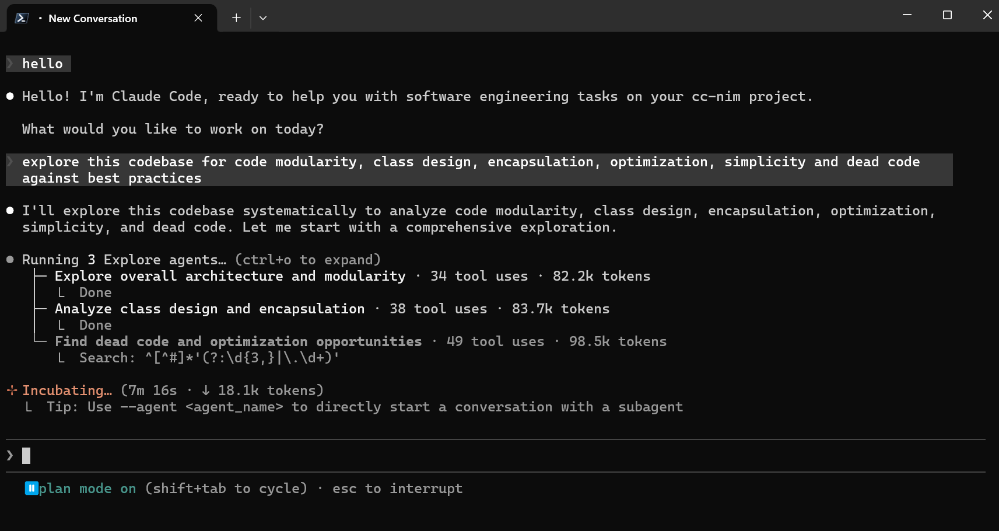
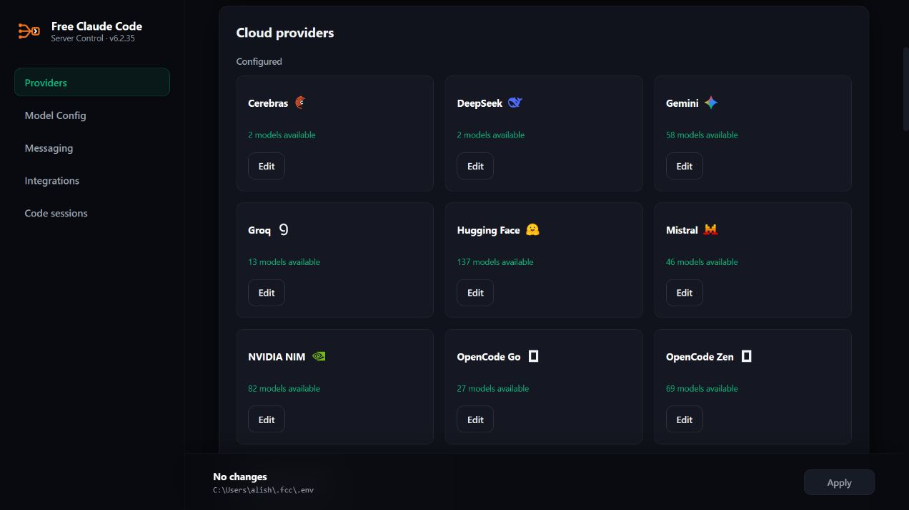
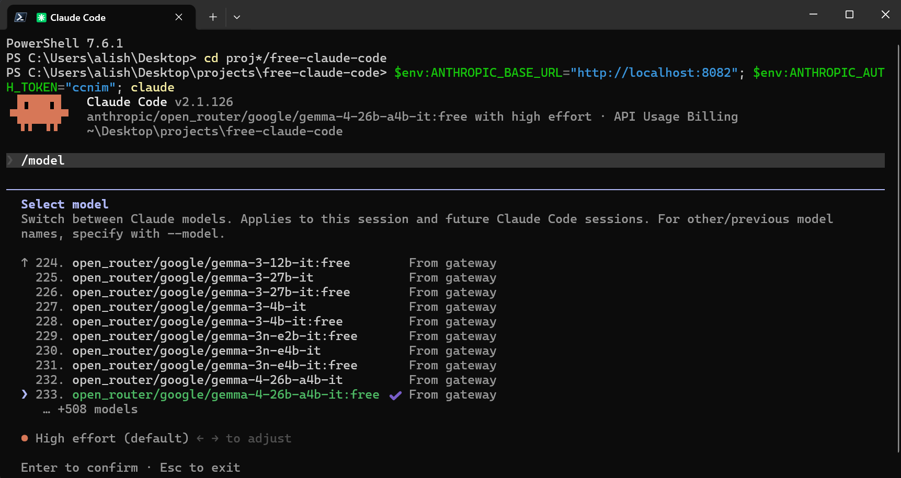

<div align="center">

<h1>
  <picture>
    <source media="(prefers-color-scheme: light)" srcset="assets/free-claude-code-wordmark-light.svg">
    
  </picture>
</h1>

[](https://github.com/Alishahryar1/free-claude-code/blob/main/LICENSE)
[](https://www.python.org/downloads/)
[](https://github.com/astral-sh/uv)
[](https://github.com/Alishahryar1/free-claude-code/actions/workflows/tests.yml)
[](https://pypi.org/project/ty/)
[](https://github.com/astral-sh/ruff)
[](https://github.com/Delgan/loguru)

[Mulai Cepat](#mulai-cepat) · [Penyedia](#pilih-penyedia) · [Hubungkan Klien](#connect-your-client) · [Integrasi Opsional](#optional-integrations) · [Kelola Instalasi](#kelola-instalasi)

</div>

<p align="center">
  <em>Proyek sumber terbuka independen. Tidak berafiliasi dengan atau didukung oleh Anthropic. Claude dan Claude Code adalah merek dagang Anthropic.</em>
</p>

## Fitur

- **61 penyedia yang mematuhi ketentuan layanan. Lebih dari 1,3 miliar token gratis setiap bulan.** Gunakan model gratis, berbayar, berlangganan, dan lokal dari satu antarmuka yang dapat ditelusuri tanpa membahayakan akun Anda. FCC mematuhi ketentuan penyedia dan menghapus integrasi jika penggunaannya tidak lagi diizinkan.
- **12 agen pemrograman. Satu katalog model.** Gunakan model FCC dengan [Claude Code](https://code.claude.com/docs/en/overview), [Codex](https://github.com/openai/codex), [Pi](https://github.com/earendil-works/pi), [OpenCode](https://github.com/anomalyco/opencode), [Cline](https://github.com/cline/cline), [Hermes](https://github.com/NousResearch/hermes-agent), [DeepSeek Harness](https://github.com/deepseek-ai/deepseek-harness), [Grok Build](https://github.com/xai-org/grok-build), [Muse Code](https://research.meta.ai/blog/introducing-muse-code-and-muse-spark-1-2/), [Aider](https://aider.chat/), [Antigravity CLI](https://antigravity.google/docs/getting-started/), atau [VS Code Chat](https://code.visualstudio.com/).
- **Tetap lanjutkan pekerjaan saat penyedia mengalami gangguan.** Setelah semua percobaan ulang gagal, FCC otomatis mencoba model berikutnya yang telah dikonfigurasi tanpa mengharuskan Anda memulai ulang giliran. Fitur ini tersedia untuk semua klien.
- **Hemat penggunaan token hingga 90%.** [RTK](https://github.com/rtk-ai/rtk) opsional menyaring keluaran perintah yang umum, sedangkan [Headroom](https://github.com/headroomlabs-ai/headroom) memadatkan hasil alat.
- **Sesi Code langsung di peramban.** Pilih folder dan jalankan Codex di peramban dengan dukungan waktu nyata maupun proses latar belakang. Beralihlah dengan mudah di antara penyedia dan model dalam sesi yang sama. Dukungan untuk beralih harness dalam sesi yang sama akan segera tersedia.
- **Terminal, komputer, IDE, atau ponsel.** Bekerjalah melalui peluncur bawaan, [VS Code](https://code.visualstudio.com/), [Codex App](https://learn.chatgpt.com/docs/app), [JetBrains](https://www.jetbrains.com/), [Discord](https://discord.com/), atau [Telegram](https://telegram.org/).
- **Kirim catatan suara, dapatkan kode.** Sampaikan instruksi kepada agen melalui transkripsi lokal [Whisper](https://github.com/openai/whisper) atau [NVIDIA NIM](https://docs.nvidia.com/nim/speech/latest/asr/deploy-asr-models/whisper.html).
- **Kemampuan agen tetap utuh.** Alirkan respons, gunakan alat, pertahankan pemikiran berselang-seling bawaan demi kinerja maksimal, kirim gambar, dan arahkan [Fable](https://www.anthropic.com/claude/fable), [Opus](https://www.anthropic.com/claude/opus), [Sonnet](https://www.anthropic.com/claude/sonnet), dan [Haiku](https://www.anthropic.com/claude/haiku) secara terpisah dengan model yang kompatibel.

Ketersediaan dan batas paket gratis ditentukan oleh masing-masing penyedia dan dapat berubah.

<div align="center">
  
  <p><em>Claude Code berjalan dengan FCC.</em></p>
</div>

<div align="center">
  
  <p><em>Sesi Codex bawaan di antarmuka peramban FCC.</em></p>
</div>

## Mulai Cepat

<a id="install"></a>

### 1. Instalasi

macOS/Linux:

```bash
curl -fsSL "https://raw.githubusercontent.com/mridwanfirdaus2603/free-claude-code/main/scripts/install.sh" | sh
```

Windows PowerShell:

```powershell
& ([scriptblock]::Create((irm "https://raw.githubusercontent.com/mridwanfirdaus2603/free-claude-code/main/scripts/install.ps1")))
```

Saat diminta, pilih setidaknya satu agen pemrograman. Anda juga dapat mengaktifkan pengoptimalan token [RTK](https://github.com/rtk-ai/rtk) dan [Headroom](https://github.com/headroomlabs-ai/headroom) untuk agen yang didukung.

### 2. Jalankan FCC

#### Windows

Buka **Free Claude Code** dari desktop atau menu Start.

#### macOS

Buka **Free Claude Code** dari desktop atau folder Applications.

#### Linux

Jalankan:

```bash
fcc-server
```

Setelah dijalankan, FCC akan membuka Antarmuka Admin. Di Windows dan macOS, gunakan ikon area notifikasi atau bar menu untuk membuka Admin, memulai ulang, atau keluar. Jika menggunakan `fcc-server`, biarkan terminal tetap terbuka.

<a id="nvidia-nim-provider"></a>

### 3. Konfigurasikan NVIDIA NIM

1. Buat kunci API di [build.nvidia.com/settings/api-keys](https://build.nvidia.com/settings/api-keys).
2. Buka URL Antarmuka Admin yang tercantum di log server.
3. Buka NVIDIA NIM pada **Providers**, klik **Add key**, tempel kunci, lalu klik **Save**.
4. Biarkan `MODEL` menggunakan nilai bawaan `nvidia_nim/nvidia/nemotron-3-ultra-550b-a55b`, atau cari model lain melalui daftar pilihan model.
5. Klik **Apply** untuk menyimpan pilihan model.

Untuk melindungi proksi lokal dengan token bearer, aktifkan **Proxy Authentication** di Admin.

<div align="center">
  
</div>

### 4. Jalankan Agen Pemrograman

Claude Code:

```bash
fcc-claude
```

Codex:

```bash
fcc-codex
```

Pi:

```bash
fcc-pi
```

OpenCode 2:

```bash
fcc-opencode
```

Cline:

```bash
fcc-cline
```

Hermes:

```bash
fcc-hermes
```

DeepSeek Harness Web:

```bash
fcc-dsh
```

Grok Build:

```bash
fcc-grok
```

Muse Code:

```bash
fcc-muse
```

Aider:

```bash
fcc-aider
```

Antigravity CLI (hubungkan terlebih dahulu melalui halaman Integrations):

```bash
fcc-agy
```

<a id="model-picker"></a>

<div align="center">
  
  <p><em>Pilih model FCC dari pemilih <code>/model</code> bawaan Claude Code.</em></p>
</div>

## Pilih Penyedia

1. Buka tautan penyedia di bawah untuk mendapatkan kunci, melihat model, atau membaca petunjuk penyiapan.
2. Atur nilai yang tercantum di Antarmuka Admin. Untuk akses langganan OpenAI / ChatGPT, gunakan **Providers → OAuth providers**.
3. Cari dan pilih model melalui daftar `MODEL`. Jika penyedia tidak dapat menampilkan daftar model, masukkan `<provider-id>/<exact-provider-model-id>` secara manual.
4. Klik **Apply**.

Opsional: tambahkan daftar berurutan **Fallback Models** pada **Model Config**. Daftar ini berlaku untuk semua klien yang terhubung. Permintaan yang gagal dapat menggunakan kuota dari lebih dari satu penyedia sebelum berhasil.

Dialog penyedia mendukung kunci API bernomor. Gunakan **Add key**, hapus baris, atau seret pegangan untuk mengubah urutannya. FCC menggunakan kunci nomor 1.

Untuk menggunakan endpoint API lain, buka **Providers → Custom providers → Add provider**. Masukkan URL dasar API, kunci opsional, dan format API. Kosongkan **Model IDs** agar model ditemukan secara otomatis, atau masukkan satu ID model hulu pada setiap baris. Simpan, lalu pilih model di **Model Config**.

<details>
<summary><strong>Katalog penyedia</strong></summary>

| Penyedia | Pengaturan Antarmuka Admin | Contoh `MODEL` |
| --- | --- | --- |
| [NVIDIA NIM](https://build.nvidia.com/settings/api-keys) | `NVIDIA_NIM_API_KEY` | `nvidia_nim/nvidia/nemotron-3-ultra-550b-a55b` |
| [OpenRouter](https://openrouter.ai/keys) | `OPENROUTER_API_KEY` | `open_router/openrouter/free` |
| [Groq](https://console.groq.com/keys) | `GROQ_API_KEY` | `groq/llama-3.3-70b-versatile` |
| [ClinePass](https://docs.cline.bot/getting-started/clinepass) | `CLINE_API_KEY` | `cline_pass/cline-pass/kimi-k3` |
| [OpenAI / ChatGPT](https://learn.chatgpt.com/docs/auth) | Hubungkan ChatGPT di Antarmuka Admin | `openai/<model-id>` |
| [OpenAI API](https://platform.openai.com/api-keys) | `OPENAI_API_KEY` | `openai_api/gpt-5.6-sol` |
| [GitHub Copilot](https://docs.github.com/en/copilot/how-tos/copilot-sdk/auth/authenticate) | Hubungkan GitHub Copilot di Antarmuka Admin | `github_copilot/<model-id>` |
| [xAI (Grok)](https://console.x.ai/team/default/api-keys) | `XAI_API_KEY` | `xai/grok-4.5` |
| [Alibaba Cloud](https://www.alibabacloud.com/help/en/model-studio/get-api-key) | `ALIBABA_CLOUD_API_KEY` | `alibaba_cloud/<model-id>` |
| [QwenCloud Token Plan](https://home.qwencloud.com/api-keys) | `QWENCLOUD_API_KEY` | `qwencloud/qwen3.7-plus` |
| [QwenCloud Coding Plan](https://home.qwencloud.com/api-keys) | `QWENCLOUD_CODING_API_KEY` | `qwencloud_coding/qwen3.7-plus` |
| [Together AI](https://api.together.ai/settings/api-keys) | `TOGETHER_API_KEY` | `together/zai-org/GLM-5.2` |
| [DeepInfra](https://deepinfra.com/dash/api_keys) | `DEEPINFRA_API_KEY` | `deepinfra/deepseek-ai/DeepSeek-V4-Flash` |
| [SiliconFlow](https://cloud.siliconflow.com/account/ak) | `SILICONFLOW_API_KEY` | `siliconflow/Qwen/Qwen3-32B` |
| [Nebius Token Factory](https://tokenfactory.nebius.com/project/api-keys) | `NEBIUS_API_KEY` | `nebius/Qwen/Qwen3-30B-A3B` |
| [Chutes](https://chutes.ai/docs/getting-started/authentication) | `CHUTES_API_KEY` | `chutes/Qwen/Qwen3-32B-TEE` |
| [Featherless AI](https://featherless.ai/account/api-keys) | `FEATHERLESS_API_KEY` | `featherless/Qwen/Qwen3-32B` |
| [Agnes AI](https://agnes-ai.com/) | `AGNES_API_KEY` | `agnes/agnes-2.0-flash` |
| [ZenMux](https://zenmux.ai/platform/pay-as-you-go) | `ZENMUX_API_KEY` | `zenmux/deepseek/deepseek-v4-flash-free` |
| [W&B Inference](https://wandb.ai/settings) | `WANDB_API_KEY` | `wandb/openai/gpt-oss-20b` |
| [Anthropic](https://platform.claude.com/settings/keys) | `ANTHROPIC_API_KEY` | `anthropic/<model-id>` |
| [Azure OpenAI](https://learn.microsoft.com/azure/foundry/openai/how-to/chatgpt) | `AZURE_OPENAI_API_KEY` dan `AZURE_OPENAI_BASE_URL` | `azure_openai/<deployment-name>` |
| [Google AI Studio (Gemini)](https://aistudio.google.com/apikey) | `GEMINI_API_KEY` | `gemini/models/gemini-3.1-flash-lite` |
| [Google Vertex AI](https://cloud.google.com/vertex-ai/generative-ai/docs/start/openai) | `VERTEX_PROJECT_ID` + ADC | `vertex/google/gemini-3.5-flash` |
| [DeepSeek](https://platform.deepseek.com/api_keys) | `DEEPSEEK_API_KEY` | `deepseek/deepseek-chat` |
| [Mistral La Plateforme](https://console.mistral.ai/) | `MISTRAL_API_KEY` | `mistral/devstral-small-latest` |
| [Mistral Codestral](https://console.mistral.ai/) | `CODESTRAL_API_KEY` | `mistral_codestral/codestral-latest` |
| [OpenCode Zen](https://opencode.ai/auth) | `OPENCODE_API_KEY` | `opencode_zen/gpt-5.3-codex` |
| [OpenCode Go](https://opencode.ai/auth) | `OPENCODE_API_KEY` | `opencode_go/minimax-m2.7` |
| [Vercel AI Gateway](https://vercel.com/docs/ai-gateway/models-and-providers) | `AI_GATEWAY_API_KEY` | `vercel/openai/gpt-5.5` |
| [Amazon Bedrock](https://console.aws.amazon.com/bedrock/) | `AWS_BEARER_TOKEN_BEDROCK` | `bedrock/openai.gpt-oss-120b` |
| [Hugging Face Inference Providers](https://huggingface.co/settings/tokens) | `HUGGINGFACE_API_KEY` | `huggingface/Qwen/Qwen3-Coder-480B-A35B-Instruct:fastest` |
| [Cohere](https://dashboard.cohere.com/api-keys) | `COHERE_API_KEY` | `cohere/command-a-plus-05-2026` |
| [Wafer](https://wafer.ai/) | `WAFER_API_KEY` | `wafer/DeepSeek-V4-Pro` |
| [Kimi API](https://platform.moonshot.ai/console/api-keys) | `KIMI_API_KEY` | `kimi/kimi-k2.5` |
| [Kimi Code](https://www.kimi.com/code/console) | `KIMI_CODE_API_KEY` | `kimi_code/k3` |
| [MiniMax](https://platform.minimax.io/user-center/basic-information/interface-key) | `MINIMAX_API_KEY` | `minimax/MiniMax-M3` |
| [Cerebras Inference](https://cloud.cerebras.ai/) | `CEREBRAS_API_KEY` | `cerebras/gpt-oss-120b` |
| [SambaNova](https://cloud.sambanova.ai/apis) | `SAMBANOVA_API_KEY` | `sambanova/Meta-Llama-3.3-70B-Instruct` |
| [Kilo.ai](https://kilo.ai) | `KILO_API_KEY` | `kilo/kilo-auto/free` |
| [Fireworks AI](https://fireworks.ai/account/api-keys) | `FIREWORKS_API_KEY` | `fireworks/accounts/fireworks/models/llama-v3p3-70b-instruct` |
| [Novita AI](https://novita.ai/settings/key-management) | `NOVITA_API_KEY` | `novita/deepseek/deepseek-v4-flash-0731` |
| [Cloudflare Workers AI](https://developers.cloudflare.com/workers-ai/) | `CLOUDFLARE_API_TOKEN` and `CLOUDFLARE_ACCOUNT_ID` | `cloudflare/@cf/moonshotai/kimi-k2.6` |
| [Z.ai Coding Plan](https://z.ai/manage-apikey/apikey-list) | `ZAI_API_KEY` | `zai/glm-5.2` |
| [Z.ai API (pay as you go)](https://z.ai/manage-apikey/apikey-list) | `ZAI_API_KEY` | `zai_api/glm-4.7-flash` |
| [TokenRouter](https://www.tokenrouter.com/) | `TOKENROUTER_API_KEY` | `tokenrouter/moonshotai/kimi-k3-free` |
| [NaraRoute](https://router.bynara.id/) | `NARAROUTE_API_KEY` | `nararoute/kimi-k3-free` |
| [Poolside AI](https://platform.poolside.ai/) | `POOLSIDE_API_KEY` | `poolside/poolside/laguna-s-2.1` |
| [LLM7.io](https://dash.llm7.io/) | `LLM7_API_KEY` | `llm7/default` |
| [Scaleway](https://console.scaleway.com/iam/api-keys) | `SCW_SECRET_KEY` | `scaleway/deepseek/deepseek-v4-flash` |
| [Lightning AI](https://lightning.ai/) | `LIGHTNING_API_KEY` | `lightning/lightning-ai/Qwen3.8-27B` |
| [Experiential Labs](https://platform.experientiallabs.ai/) | `EXPLABS_API_KEY` | `experiential/union-alpha` |
| [Cheaper Inference](https://cheaperinference.com/signup) | `CHEAPER_INFERENCE_API_KEY` | `cheaperinference/gpt-5.4-mini` |
| [OrcaRouter](https://www.orcarouter.ai/) | `ORCAROUTER_API_KEY` | `orcarouter/deepseek/deepseek-v4-flash-free` |
| [Atlas Cloud](https://console.atlascloud.ai/api-keys) | `ATLASCLOUD_API_KEY` | `atlascloud/deepseek-ai/deepseek-v4-flash` |
| [xKiro](https://xkiro.com/) | `XKIRO_API_KEY` | `xkiro/qwen/qwen3.7-flash:free` |
| [Opper](https://platform.opper.ai/) | `OPPER_API_KEY` | `opper/claude-sonnet-4-6` |
| [Ollama Cloud](https://ollama.com/settings/keys) | `OLLAMA_API_KEY` | `ollama_cloud/qwen3-coder:480b` |
| [LM Studio](https://lmstudio.ai/) | `LM_STUDIO_BASE_URL` | `lmstudio/<model-id>` |
| [llama.cpp](https://github.com/ggml-org/llama.cpp) | `LLAMACPP_BASE_URL` | `llamacpp/<model-id>` |
| [Ollama](https://ollama.com/) | `OLLAMA_BASE_URL` | `ollama/<model-tag>` |

</details>

<details>
<summary><strong>Penyiapan khusus penyedia</strong></summary>

- OpenAI / ChatGPT menggunakan langganan ChatGPT Anda, bukan kunci API. Hubungkan melalui
  **Providers → OAuth providers → OpenAI / ChatGPT → Connect** di Antarmuka Admin,
  lalu selesaikan proses masuk melalui peramban. Mulai ulang agen yang sudah berjalan setelah terhubung.
- Anthropic menggunakan kunci API dengan penagihan terpisah. Tambahkan kunci melalui
  **Providers → Cloud providers → Anthropic → Configure**, lalu pilih model yang ditemukan.
  Kunci untuk beberapa ruang kerja juga memerlukan `ANTHROPIC_WORKSPACE_ID`.
- OpenAI API menggunakan kunci Platform API tersendiri. Masukkan kunci melalui
  **Providers → Cloud providers → OpenAI API → Configure**. Daftar model mungkin
  mencakup ID yang tidak dapat menangani permintaan pemrograman. Pilih model untuk pembuatan teks.
- GitHub Copilot menggunakan akun GitHub yang sedang Anda gunakan beserta langganannya. Pasang
  [Copilot CLI 1.0.83](https://github.com/github/copilot-cli/releases/tag/v1.0.83)
  di PATH, lalu pilih **Providers → OAuth providers → GitHub Copilot → Connect**.
  Selesaikan proses masuk, kemudian pilih `github_copilot/<model-id>` dari pemilih model.
  Model dan kuota yang tersedia bergantung pada langganan serta kebijakan organisasi Anda.
  Mulai ulang agen yang sudah berjalan setelah terhubung.
- Azure OpenAI menggunakan nama deployment dari sumber daya Anda. Atur
  `AZURE_OPENAI_BASE_URL` ke endpoint v1 lengkap, misalnya
  `https://YOUR-RESOURCE-NAME.openai.azure.com/openai/v1/`, lalu pilih deployment
  yang mendukung Chat Completions. Jika nama deployment tidak muncul di daftar model,
  masukkan nama tersebut sebagai slug model khusus.
- Mistral Codestral menggunakan kunci yang berbeda dari Mistral La Plateforme.
- Kunci langganan Kimi Code menggunakan awalan `kimi_code/`. Kunci kredit Kimi API
  menggunakan awalan `kimi/`. Paket Kimi Code ditujukan untuk penggunaan agen
  pemrograman interaktif pribadi sesuai [pedoman komunitas Kimi](https://www.kimi.com/code/docs/en/kimi-code/community-guidelines.html).
- Alibaba Cloud menggunakan kunci bayar sesuai pemakaian Model Studio dan secara
  bawaan menggunakan wilayah Singapura. Untuk wilayah atau ruang kerja lain, atur
  `ALIBABA_CLOUD_BASE_URL` ke [endpoint yang kompatibel dengan OpenAI](https://www.alibabacloud.com/help/en/model-studio/base-url)
  yang berakhiran `/compatible-mode/v1`. Kunci dan endpoint harus menggunakan wilayah yang sama.
- Kunci QwenCloud Coding Plan menggunakan awalan `qwencloud_coding/`, sedangkan
  kunci QwenCloud Token Plan menggunakan `qwencloud/`. Kunci dan endpoint tersebut
  tidak dapat saling dipertukarkan. Coding Plan ditujukan untuk penggunaan agen
  pemrograman interaktif pribadi dan lokal sesuai [ketentuan Coding Plan](https://www.alibabacloud.com/help/en/model-studio/coding-plan).
- OpenCode Zen dan OpenCode Go menggunakan `OPENCODE_API_KEY` yang sama, tetapi
  memakai awalan model `opencode_zen/` dan `opencode_go/`.
- Untuk Amazon Bedrock, atur `BEDROCK_BASE_URL` ke URL di wilayah yang sama dengan
  kunci API, lalu pilih salah satu model yang tercantum.
- Vertex AI menggunakan Google Application Default Credentials, bukan kunci API.
  Untuk penggunaan lokal, jalankan `gcloud auth application-default login` satu kali.
  Berkas akun layanan dan akun layanan yang terpasang juga dapat digunakan. Atur
  `VERTEX_PROJECT_ID`, dan ubah `VERTEX_LOCATION` dari nilai bawaan `global` bila perlu.
- Cloudflare memerlukan token API dan ID akun.
- Untuk Ollama Cloud, gunakan ID model persis seperti yang ditampilkan pada pemilih
  model. Ollama lokal menggunakan awalan terpisah `ollama/`.
- Utamakan model yang mendukung alat untuk agen pemrograman. Model lokal juga
  memerlukan konteks yang cukup untuk perintah sistem dan definisi alat agen.

</details>

<details>
<summary><strong>Penyiapan penyedia lokal</strong></summary>

Saat dijalankan, FCC otomatis menemukan model dari server lokal yang aktif. Jika server baru dijalankan kemudian, klik **Refresh models** di Admin untuk menambahkan modelnya ke pemilih.

### LM Studio

Jalankan server lokal LM Studio, muat model yang mendukung alat, lalu gunakan pengenal model yang ditampilkan LM Studio dengan awalan `lmstudio/`. URL bawaannya adalah `http://localhost:1234/v1`.

### llama.cpp

Jalankan `llama-server` dengan API Chat Completions yang kompatibel dengan OpenAI dan konteks yang memadai untuk model. Gunakan ID model lokal dengan awalan `llamacpp/`. Nilai bawaan `LLAMACPP_BASE_URL` adalah `http://localhost:8080/v1`.

### Ollama

```bash
ollama pull llama3.1
ollama serve
```

Gunakan tag yang ditampilkan oleh `ollama list` dengan awalan `ollama/`. Nilai bawaan `OLLAMA_BASE_URL` adalah `http://localhost:11434`.

Kartu penyedia menampilkan endpoint yang diperiksa dan waktu respons, serta pesan yang informatif jika server lokal tidak tersedia. Setelah menjalankan server atau memperbaiki pengaturannya, klik **Test** untuk memperbarui daftar model.

</details>

<details>
<summary><strong>Perutean tingkat model opsional</strong></summary>

`MODEL` menjadi model cadangan untuk setiap permintaan. Pilih model untuk `MODEL_FABLE`, `MODEL_OPUS`, `MODEL_SONNET`, atau `MODEL_HAIKU` guna mengganti model pada tingkat Claude Code tertentu. Pilih **None** untuk menggunakan `MODEL`.

Di **Admin UI → Model Config**, tambahkan **Fallback Models** sesuai urutan percobaan FCC jika model yang dipilih gagal. Setiap model cadangan memiliki tingkat upaya penalaran sendiri: **Inherit**, **Off**, **From client**, **Low**, **Medium**, **High**, **X-High**, atau **Max**.

Pilih model, tingkat upaya, dan nomor kunci API pada baris paling bawah, lalu klik **+**. **Key 1**, **Key 2**, dan seterusnya merujuk pada kunci bernomor yang sedang diatur untuk penyedia tersebut. Ubah pilihan secara langsung, seret pegangan untuk mengubah urutan, atau klik tombol hapus berwarna merah untuk menghapus model cadangan.

**Inherit** mempertahankan pengaturan penalaran yang telah ditetapkan pada permintaan awal. **From client** menggunakan tingkat upaya atau anggaran token yang dikirim agen pemrograman, tanpa mengikuti pengaturan global atau tingkat model. Anda dapat memilih model yang sama dengan nomor kunci lain.

</details>

<details>
<summary><strong>Kontrol penalaran</strong></summary>

Buka **Admin UI → Model Config → Model Routing**, lalu pilih tingkat upaya di samping setiap model. Nilai awal **Default Effort** adalah **From client**. Fable, Opus, Sonnet, dan Haiku menggunakan **Inherit** sebagai nilai awal.

| Pilihan | Perilaku |
| --- | --- |
| **From client** | Gunakan tingkat upaya yang dikirim agen pemrograman. Jika tidak ada, gunakan nilai bawaan penyedia. |
| **Off** | Minta agar penalaran dinonaktifkan. |
| **Low**, **Medium**, **High**, **X-High**, atau **Max** | Ganti pengaturan klien dengan tingkat penalaran yang dipilih. |
| **Inherit** | Penggantian tingkat model menggunakan Default Effort. Model cadangan mempertahankan tingkat upaya permintaan awal yang telah ditetapkan. |

</details>

<a id="connect-your-client"></a>

## Hubungkan Klien Anda

Peluncur FCC menjalankan server secara otomatis.

Untuk mengintegrasikan editor dan aplikasi, pasang klien, jalankan FCC, lalu buka
**Admin UI → Integrations** dan klik **Connect** pada kartunya.

- **Claude Code di VS Code**: Pasang [ekstensi Claude Code](https://marketplace.visualstudio.com/items?itemName=anthropic.claude-code).
- **VS Code Chat**: Pasang [VS Code](https://code.visualstudio.com/) versi terbaru, hubungkan, lalu pilih model FCC dari pemilih model Chat bawaan.
- **Claude Desktop**: Pasang [Claude Desktop](https://claude.ai/download). Keluar sepenuhnya sebelum menghubungkan atau memutuskan koneksi, lalu buka kembali. Setelah koneksi diputus, Anda dapat masuk ke Claude seperti biasa.
- **Codex di VS Code dan aplikasi**: Pasang [ekstensi Codex](https://marketplace.visualstudio.com/items?itemName=openai.chatgpt) atau Codex App.
- **DeepSeek Harness Desktop**: Pasang dan buka aplikasi satu kali sebelum menghubungkannya. Mulai sesi baru untuk menggunakan model FCC.
- **Claude Code di JetBrains ACP**: Pasang Claude Agent di JetBrains AI Assistant dan jalankan satu kali, lalu klik **Connect** di FCC. Buka kembali IDE, pilih **Claude Code (FCC)**, dan mulai obrolan baru. Setelah JetBrains memperbarui agen, mulai ulang FCC sebelum memulai obrolan baru. IDE harus terpasang secara lokal di lokasi pemasangan standar.

Muat ulang VS Code atau mulai ulang aplikasi/IDE setelah menghubungkan. Di Codex dan Claude Desktop, pilih model FCC dari pemilih model. Muat ulang atau mulai ulang klien saat FCC melaporkan pengaturan yang diperbarui. Gunakan **Disconnect** pada kartu yang sama untuk menghapus integrasi.

Untuk menyelesaikan orientasi awal Claude Code secara terpisah, buka **Admin UI → Integrations →
Claude Code onboarding**, lalu klik **Complete onboarding**. Menghubungkan Claude Code
di VS Code juga menyelesaikan orientasi awal.

Jalankan FCC di komputer dan lingkungan pengguna yang sama dengan klien yang sedang Anda konfigurasi.

<a id="optional-integrations"></a>

## Integrasi Opsional

Konfigurasikan integrasi melalui **Admin UI → Messaging**, lalu klik **Apply**.

<details>
<summary><strong>Discord bot</strong></summary>

1. Buat bot di [Discord Developer Portal](https://discord.com/developers/applications).
2. Aktifkan **Message Content Intent** dan undang bot dengan izin membaca,
   mengirim pesan, melihat riwayat pesan, serta **Manage Messages** agar `/clear`
   dapat menghapus permintaan pengguna.
3. Atur **Messaging Platform** ke **discord**.
4. Masukkan **Discord Bot Token**, **Allowed Discord Channels**, dan **Allowed Directory** dengan jalur absolut.
5. Terapkan pengaturan dan mulai ulang server jika diminta.

</details>

<details>
<summary><strong>Telegram bot</strong></summary>

1. Buat bot melalui [@BotFather](https://t.me/BotFather).
2. Dapatkan ID pengguna numerik Anda dari [@userinfobot](https://t.me/userinfobot).
   Di grup, berikan izin kepada bot untuk menghapus pesan.
3. Atur **Messaging Platform** ke **telegram**.
4. Masukkan **Telegram Bot Token**, **Allowed Telegram User ID**, dan **Allowed Directory** dengan jalur absolut.
5. Terapkan pengaturan dan mulai ulang server jika diminta.

</details>

### Perintah pesan

| Penggunaan | Perilaku |
| --- | --- |
| `/stats` | Tampilkan status sesi. |
| `/stop` sebagai pesan tersendiri | Batalkan semua pekerjaan. |
| Balas dengan `/stop` | Batalkan hanya permintaan yang dipilih, sementara permintaan lain dalam antrean tetap berjalan. |
| `/clear` sebagai pesan tersendiri | Hapus semua percakapan FCC beserta pesannya di obrolan ini. |
| Balas dengan `/clear` | Hapus pesan yang dipilih dan rangkaian balasan terhadapnya. Percakapan lain tetap dipertahankan. |

<details>
<summary><strong>Catatan suara</strong></summary>

Transkripsi NVIDIA NIM tersedia pada setiap instalasi. Di **Admin UI → Messaging → Voice**, aktifkan catatan suara, pilih `nvidia_nim`, lalu pilih model yang didukung. Atur **NVIDIA NIM API key** Anda di halaman Providers.

Untuk menggunakan Whisper secara lokal dengan CPU atau CUDA, jalankan kembali pemasang dengan opsi suara lokal:

macOS/Linux:

Whisper lokal dengan CPU atau CUDA:

```bash
curl -fsSL "https://raw.githubusercontent.com/mridwanfirdaus2603/free-claude-code/main/scripts/install.sh" | sh -s -- --voice-local
```

Whisper lokal dengan CUDA 13.0:

```bash
curl -fsSL "https://raw.githubusercontent.com/mridwanfirdaus2603/free-claude-code/main/scripts/install.sh" | sh -s -- --voice-local --torch-backend cu130
```

Windows PowerShell:

Whisper lokal dengan CPU atau CUDA:

```powershell
& ([scriptblock]::Create((irm "https://raw.githubusercontent.com/mridwanfirdaus2603/free-claude-code/main/scripts/install.ps1"))) -VoiceLocal
```

Whisper lokal dengan CUDA 13.0:

```powershell
& ([scriptblock]::Create((irm "https://raw.githubusercontent.com/mridwanfirdaus2603/free-claude-code/main/scripts/install.ps1"))) -VoiceLocal -TorchBackend cu130
```

Setelah memasang dukungan lokal, mulai ulang `fcc-server`. Di **Admin UI → Messaging → Voice**, aktifkan catatan suara, pilih `cpu` atau `cuda`, lalu pilih model Whisper. Model lokal yang aksesnya dibatasi memerlukan `HUGGINGFACE_API_KEY`.

</details>

## Kelola Instalasi

Jalankan `fcc-server --version` untuk memeriksa versi yang terpasang tanpa menjalankan FCC.

### Perbarui

Hentikan semua perintah FCC yang sedang berjalan, lalu jalankan:

```sh
fcc-update
```

Pembaruan mengambil versi terbaru FCC dari cabang `main` fork dan menjalankan pemasang yang sesuai.

Untuk memasang ulang FCC atau mengubah komponen opsional meskipun sudah menggunakan versi terbaru, jalankan [pemasang](#install) secara langsung.

Untuk dukungan suara lokal, sertakan `--voice-local` (macOS/Linux) atau `-VoiceLocal` (Windows), serta opsi `--torch-backend` atau `-TorchBackend` jika digunakan.

### Muse Code di Windows tanpa WSL

Untuk memasang atau memperbarui Muse Code saja:

```powershell
& ([scriptblock]::Create((irm "https://raw.githubusercontent.com/mridwanfirdaus2603/free-claude-code/main/scripts/install-muse.ps1")))
```

Untuk menghapus Muse Code yang dipasang oleh FCC tanpa menghapus datanya:

```powershell
& ([scriptblock]::Create((irm "https://raw.githubusercontent.com/mridwanfirdaus2603/free-claude-code/main/scripts/uninstall-muse.ps1")))
```

Menghapus FCC tidak akan menghapus Muse Code.

### Hapus Instalasi

Hentikan semua perintah FCC yang sedang berjalan dan tutup aplikasi desktop/editor yang terhubung sebelum menghapus instalasi.

**Yang dihapus**

- Free Claude Code, termasuk peluncur desktop dan perintahnya
- `~/.fcc/`

**Yang tetap dipertahankan**

- uv dan Python
- Agen pemrograman, RTK, dan Headroom Anda

macOS/Linux:

```bash
curl -fsSL "https://raw.githubusercontent.com/mridwanfirdaus2603/free-claude-code/main/scripts/uninstall.sh" | sh
```

Windows PowerShell:

```powershell
& ([scriptblock]::Create((irm "https://raw.githubusercontent.com/mridwanfirdaus2603/free-claude-code/main/scripts/uninstall.ps1")))
```

## Tautan Proyek

Jika mengalami masalah setelah instalasi, jalankan perintah berikut dan sertakan keluarannya dalam laporan bug Anda.

```bash
fcc-doctor
```

- [Laporkan bug atau ajukan permintaan fitur](https://github.com/Alishahryar1/free-claude-code/issues)
- [Panduan kontribusi](CONTRIBUTING.md)

## Lisensi

GNU Affero General Public License versi 3 saja (`AGPL-3.0-only`). Baca [LICENSE](LICENSE) untuk informasi lebih lanjut.
